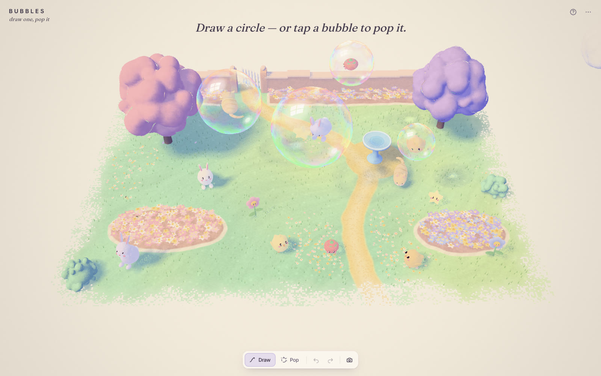
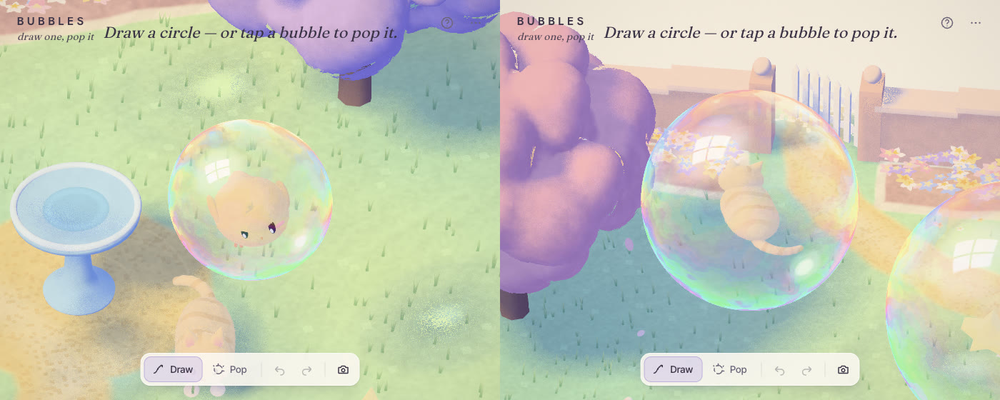
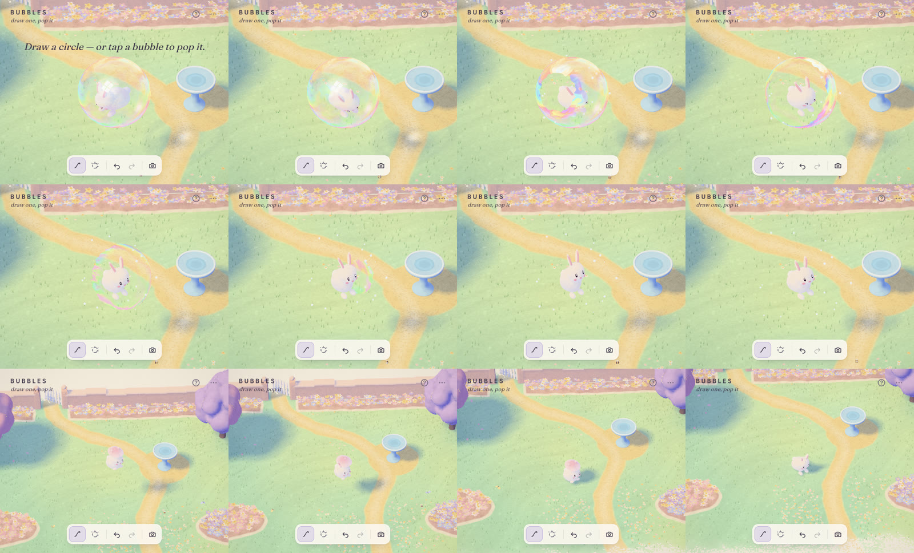
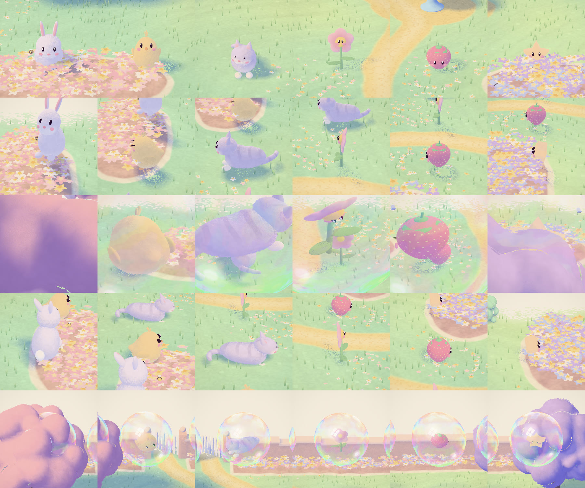

# BUBBLES

**Draw a circle over a pastel garden. It becomes a shimmering soap bubble with something tiny asleep inside, and it floats away. Tap it and it pops — and whoever was inside drifts down on a petal.**



BUBBLES is a piece in a family by the same hand — [MEADOW](https://github.com/Mariaareadne1/meadow-interactive) (draw a sheep), POND, HIVE, [SKY](https://github.com/Mariaareadne1/sky-interactive), TIDE, DUCKLINGS, HARBOR and LANTERNS — and its first pastel one. One thing to draw, one thing it makes, one thing to do to it:

- **Draw a roughly round loop** anywhere over the garden. On release it inflates into a soap bubble the size of your circle, right where you drew it, with someone curled up asleep inside — a **bunny**, a **chick**, a **kitten**, a **flower**, a **strawberry** or a **star**.
- Bubbles **float** up and drift on a soft, slowly turning breeze, sink a little and rise again, and never leave the air above the garden. They bump softly with a wobble; two that meet slowly **merge** into one bigger bubble (volume conserved) with both passengers snuggled inside. After about two minutes a bubble pops by itself.
- **Tap a bubble to pop it.** The film bursts open from where you tapped in a ring of colour and a few droplets; the passenger wakes with a start and drifts down — the animals under a petal, the flower, strawberry and star twirling on their own — and lands right under where it was. It stays: the bunny hops about and nibbles, the chick pecks and peeps, the kitten stretches, bats at a butterfly and naps, the flower nods, the strawberry wiggles, the star twinkles. The garden slowly fills up.
- **Pop** mode: swipe across bubbles and every one you touch pops.
- **Click a friend in the garden** to give it a name (🎲 for a suggestion), **Bubble up** (a new bubble forms round it and it floats back up, asleep again), or **Remove** it (it waves and fades). Drag to move it.

Demo (≈19 s, recorded by the app's own recorder): [`docs/media/bubbles-demo.mp4`](docs/media/bubbles-demo.mp4)

| | |
|---|---|
|  |  |
|  |  |

## Controls

| | |
|---|---|
| Draw a closed loop | A bubble, with someone asleep inside |
| Tap / click a bubble | Pop it |
| Pop tool, then swipe | Pop every bubble the swipe touches |
| Click a friend in the garden | Name · Bubble up · Remove; drag to move |
| D · P | Draw · Pop |
| B · Delete | Bubble up · Remove the selected friend |
| Tab · Esc | Next friend · deselect / cancel |
| ⌘Z · ⇧⌘Z | Undo · redo |
| H | Hide the interface |

The menu has Showcase, Record 12-second clip (with the drawn line composited in), Hide interface, Export/Import scene and Clear the garden. The garden is saved in the browser (a versioned, validated document capped at 16 bubbles and 24 friends); bubbles reload as old as they are.

## Running it

```bash
npm install
npm run dev          # http://localhost:5398
npm test             # unit tests (Vitest)
npm run test:e2e     # Playwright in real Chromium (Metal ANGLE)
E2E_PROD=1 npm run test:e2e   # the same against the production build
npm run build
```

QA scripts (with the dev server running): `node scripts/shoot.mjs <name> [query] [w] [h] [waitMs]`, `node scripts/closeup.mjs <name> [bubbleId] [fov] [frames] [every]`, `node scripts/pop.mjs <prefix>`, `node scripts/passengers.mjs <prefix>`, `node scripts/perf.mjs`, `node scripts/demo.mjs`, `node scripts/verify-recording.mjs [file]`, `node scripts/gallery.mjs`. URL flags: `?empty`, `?showcase`, `?quality=low`, `?noshell`.

## How it's made

Vite + TypeScript + plain Three.js with custom `ShaderMaterial`s; React only for the interface. Everything is procedural — no textures, models or photos. See [`docs/ART_DIRECTION.md`](docs/ART_DIRECTION.md) for the pastel palette and how it maps to MEADOW's, [`CASE_STUDY.md`](CASE_STUDY.md) for the decisions and what went wrong, and [`docs/SIBLINGS.md`](docs/SIBLINGS.md) for what was adapted from the family.

MIT licensed.
